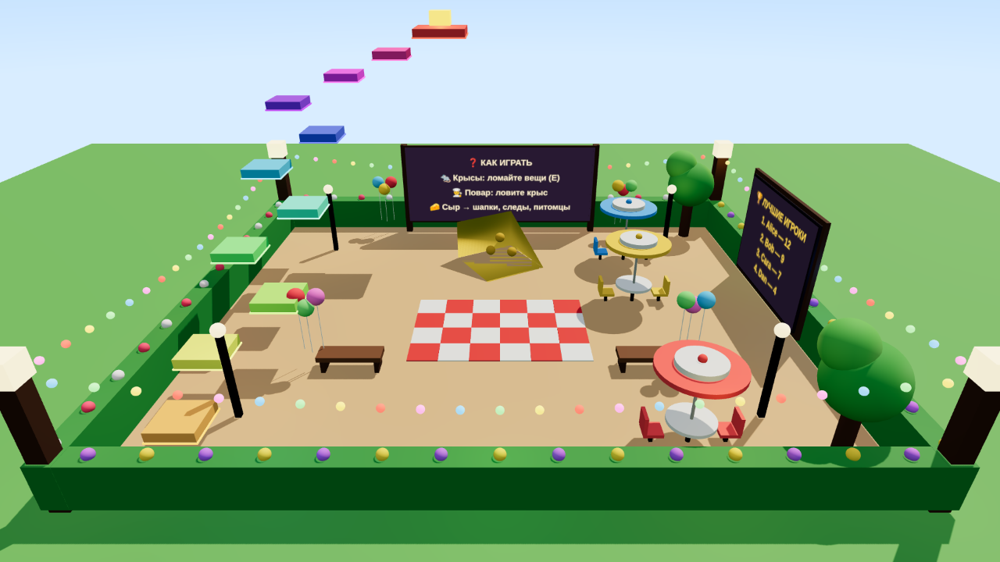

# 🐀 Крысиный Переполох / Rat Ruckus — игра для Roblox (версия 2)

**Жанр:** командная игра «крысы против повара».
Ночью в ресторане 2–7 крыс устраивают хаос, а повар (игрок или робот) пытается их переловить.

## 🌞 Версия 7: светлое и безопасное лобби
- В лобби **светлый день** (каждый игрок видит его у себя на экране), а когда начинается раунд, плавно наступает ночь.
- Вокруг лобби **живая изгородь с цветами** и **невидимые стены до неба**: упасть в бездну больше нельзя. Паркур работает как раньше.
- Если игрок всё-таки упал с карты (ниже `Config.FallRescueY`), его сразу возвращает назад.
- Украшения: гирлянды из разноцветных лампочек, фонари по углам, столики кафе с зонтиками, воздушные шарики, деревья, клетчатый коврик, сад с травой вокруг.
- Ночь в ресторане стала чуть светлее.



## 🎟️ Версия 6: ещё 5 пропусков (Game Passes)
| Пропуск | Что даёт | Цена | Куда вставить ID |
|---|---|---|---|
| 🍀 Второй шанс | первый раз за раунд клетка открывается сама через 3 сек | R$ 199 | `Config.GamePasses.SecondChance` |
| 🏃 Бесконечный бег | бег (Shift) не заканчивается | R$ 149 | `Config.GamePasses.InfiniteStamina` |
| ⭐ ×2 Опыт | весь опыт удваивается | R$ 99 | `Config.GamePasses.DoubleXP` |
| 🪩 Мега-танцы | танцы «Диско» (N) и «Червяк» (M); без пропуска игра сразу предлагает купить | R$ 79 | `Config.GamePasses.MegaDances` |
| 🍳 Пропуск повара | если включил «Хочу быть поваром», выбирают тебя первым | R$ 99 | `Config.GamePasses.ChefPass` |

Создай каждый пропуск на create.roblox.com → **Monetization → Passes**, поставь цену и вставь ID в `Config`.

## 🛒 Версия 5: красивый магазин (всё за сыр или за Robux)
- Новый дизайн: категории слева, карточки с редкостью (Обычный / Редкий / Эпический / Легендарный), значки «🔥 ХИТ», анимация при наведении, подстройка под экран телефона.
- **Любой** предмет (шапка, след, класс, питомец) можно купить за 🧀 **или** за R$.
- Для этого создай **4 Developer Product** и вставь их ID в `Config.ItemTiers`:
  - T1 = R$ 25 (предметы до 100 🧀), T2 = R$ 49 (до 250 🧀), T3 = R$ 99 (до 500 🧀 и предметы за уровень), T4 = R$ 149 (дороже).
  - Если игрок заплатил, а предмет у него уже есть (или выбран не тот уровень), он получает сыр, и Robux не пропадают.

## 🔥 Версия 4 (вирусное обновление)
- **🎟️ Коды** для TikTok и YouTube: `TIKTOK` (+500), `RATS` (+250), `RELEASE` (+300), `CHEESE` (+150). Свои коды добавляй в `Config.Codes`.
- **🐹 Питомцы** летают и бегают за тобой и дают +5…30% сыра (Таракан, Хомяк, Голубь, Сырный слайм, Мини-дракон за 15 уровень, Золотой хомяк для VIP).
- **📜 Задания дня**: 3 новых задания каждый день с наградой.
- **🏆 Глобальная таблица побед** в лобби (OrderedDataStore).
- **💃 Танцы крыс**: Z — танец, X — сальто, C — привет, V — притвориться мёртвой (на телефоне кнопка 💃).
- **🧟 Событие «Гигантский повар»**: огромный повар с длинным сачком.
- **👥 Друзья**: кнопка «Пригласить» и +20% сыра, если играешь с другом.
- **🧗 Паркур в лобби**: золотой сыр наверху, +75 🧀 раз в день.

## 🆕 Версия 3 (мега-обновление)
- **🐀 Классы крыс** со способностью на **F**: ⚡ Быстрая (рывок), 💪 Сильная (ломает быстрее + броня от сачка), 🥷 Невидимка (невидимость 4 сек).
- **✨ Следы** за крысой (искры, сердечки, огонь, лёд, радуга, VIP-галактика).
- **⭐ Уровни**: опыт за всё, +50 🧀 за уровень, шапки за 5, 10 и 20 уровень.
- **🍕 Вторая карта — Пиццерия** (аркада, печь, тестомес, касса) и **голосование за карту** в лобби.
- **🎲 События раунда**: 🌋 Ночь хаоса, ✨ Золотой час, 🏎️ Турбо.
- **💎 Новые покупки за Robux**: пропуск «Все классы», 🔓 «Сбежать из клетки», 👨‍🍳 «Стать поваром в следующем раунде».
- **Понятно новичкам**: стрелка к ближайшему заданию, подсказки «Как играть» в первом раунде, доска с правилами в лобби.

## ✨ Что есть в игре

**Крысы 🐀**
- Живые крысы: хвост виляет, лапки бегают, голова принюхивается, глаза блестят.
- **Шапки** из магазина (11 штук: кепка, ковбойская шляпа, тыква 🎃, корона 👑, нимб 😇...).
- **Мини-игры** при поломке: 🔌 соединить провода, 🦷 быстро грызть, 🔢 подобрать пароль, ⏱ нажать вовремя.
  Пока крыса играет в мини-игру, она стоит на месте, и повар может подкрасться!
- Бег (Shift), голод и сыр 🧀, **писк (Q)** (зовёт друзей, но повар его слышит!).
- **Крысиные лазейки** в стенах: крыса пролезает, повар нет. Плюс норки-телепорты.
- Спасение друзей из клетки.

**Повар 👨‍🍳**
- Сачок, **мышеловки**, ремонт, фонарик на колпаке, бег.
- Во время тревоги (хаос ≥ 75%) повар **в ярости** и бегает быстрее.
- Если игроков мало, играет **повар-робот**: видит крыс, слышит шум, чинит, ставит мышеловки.

**Атмосфера и эффекты**
- Ночной ресторан: лунный свет из окон, мерцающие свечи, камин, пылинки в свете ламп.
- Конфетти при поломке, тряска камеры, мигающий свет, когда перегрызли провода.
- 🚨 **Тревога**: красные лампы и красные края экрана.
- 💓 **Сердцебиение**: когда повар близко, края экрана пульсируют.
- Шаги повара слышно издалека.
- Отсчёт «3, 2, 1, ХАОС!», карточка роли, экран результатов, лучший игрок.

**🌍 Два языка: русский и английский**
- Язык выбирается автоматически по настройкам Roblox игрока.
- Все тексты в модуле `Locale`. Чтобы добавить язык, скопируй блок `en` и переведи.

**Прогресс**
- Сыр-монетки 🧀 за поломки, спасения, поимки и победы. Таблица игроков (Сыр / Победы).
- **Сохранение** монеток, побед и шапок между играми.

## 🎮 Управление

| | Крыса 🐀 | Повар 👨‍🍳 |
|---|---|---|
| Ходить / прыгать | WASD / Пробел | WASD / Пробел |
| Бег | Shift | Shift |
| Действие | **E**: напакостить / открыть клетку | **E**: починить |
| Особое | **Q**: пискнуть | **1**: сачок, **2**: мышеловка, клик: использовать |
| Задания | Tab | Tab |

На телефоне появляются кнопки 🏃 (бег) и 🐭 (писк).

---

## 📦 Самый простой способ: готовый файл игры
1. Скачай **[RatRuckus.zip](https://github.com/Brownie1230/-/raw/claude/roblox-rat-game/roblox-rat-game/RatRuckus.zip)** и открой его, внутри будет `RatRuckus.rbxlx`.
2. Дважды кликни `RatRuckus.rbxlx`, и он откроется в Roblox Studio. Все 15 скриптов уже на месте, StreamingEnabled выключен.
3. Чтобы обновить свою игру: **File → Publish to Roblox As… →** твоя игра **→** её место **→ Overwrite**.

Файл собирается командой `python3 tools/build_place.py` (запускай после изменений в `src`).

## ⚡ Установка с нуля (15 скриптов)

1. Roblox Studio → **New** → **Baseplate**. Открой **View → Explorer**.
2. Создай скрипты **с точно такими именами** (наведи на папку → **⊕**):

| Где создать | Тип | Имя | Код |
|---|---|---|---|
| ReplicatedStorage | **ModuleScript** | `Config` | `src/ReplicatedStorage/Config.lua` |
| ReplicatedStorage | **ModuleScript** | `Locale` | `src/ReplicatedStorage/Locale.lua` |
| ServerScriptService | **Script** | `GameManager` | `src/ServerScriptService/GameManager.server.lua` |
| ServerScriptService | **ModuleScript** | `RatBuilder` | `src/ServerScriptService/RatBuilder.lua` |
| ServerScriptService | **ModuleScript** | `DataService` | `src/ServerScriptService/DataService.lua` |
| ServerScriptService | **ModuleScript** | `SabotageService` | `src/ServerScriptService/SabotageService.lua` |
| ServerScriptService | **ModuleScript** | `ChefService` | `src/ServerScriptService/ChefService.lua` |
| ServerScriptService | **ModuleScript** | `ChefAI` | `src/ServerScriptService/ChefAI.lua` |
| ServerScriptService | **ModuleScript** | `TestMapBuilder` | `src/ServerScriptService/TestMapBuilder.lua` |
| ServerScriptService | **ModuleScript** | `MonetizationService` | `src/ServerScriptService/MonetizationService.lua` |
| ServerScriptService | **ModuleScript** | `PetService` | `src/ServerScriptService/PetService.lua` |
| ServerScriptService | **ModuleScript** | `ExtrasService` | `src/ServerScriptService/ExtrasService.lua` |
| StarterPlayer → StarterPlayerScripts | **LocalScript** | `RatHUD` | `src/StarterPlayerScripts/RatHUD.client.lua` |
| StarterPlayer → StarterPlayerScripts | **LocalScript** | `Effects` | `src/StarterPlayerScripts/Effects.client.lua` |
| StarterPlayer → StarterPlayerScripts | **LocalScript** | `MiniGames` | `src/StarterPlayerScripts/MiniGames.client.lua` |

3. В каждый скрипт: **Cmd/Ctrl + A**, затем **Cmd/Ctrl + V** с кодом из файла.
4. Нажми **Play** ▶.

## 🔄 Обновление с версии 1

- **Заменить код** в 8 старых скриптах (двойной клик по скрипту, Cmd+A, Cmd+V).
- **Добавить 3 новых:** `DataService` (ModuleScript в ServerScriptService), `Effects` и `MiniGames` (LocalScript в StarterPlayerScripts).

## 💎 Донат (Robux)

В магазине есть вкладка **💎 Магазин**: VIP (×2 сыра, золотая корона, блеск), пропуск ×2 Сыр и пачки сыра.
1. **create.roblox.com** → твоя игра → **Monetization** → **Passes** → **Create a Pass**: создай «VIP», «×2 Сыр», «Все классы», «Второй шанс», «Бесконечный бег», «×2 Опыт», «Мега-танцы», «Пропуск повара».
2. **Monetization** → **Developer Products** → **Create**: пачки «500 сыра», «2500 сыра», «10000 сыра», «Сбежать из клетки», «Стать поваром».
3. Скопируй **ID** каждого товара и вставь в `Config` (`Config.GamePasses` и `Config.Products`). Пока стоит 0, кнопка показывает «Скоро».

Ещё в игре: **ежедневный бонус** (чем больше дней подряд, тем больше сыра) и **золотой сыр** ✨, который появляется в труднодоступных местах.

## 💾 Чтобы сохранялись монетки и шапки

1. Опубликуй игру: **File → Publish to Roblox**.
2. **Home → Game Settings → Security** → включи **Enable Studio Access to API Services** → **Save**.

Без этого игра работает, просто прогресс не сохраняется (в Output будет жёлтое предупреждение).

## 💡 Советы

- **Lighting → Technology = Future**: так свет и тени будут гораздо красивее.
- **Музыка и сердцебиение**: в `Config` → `Config.Sounds` вставь ID звуков из Toolbox
  (правый клик по звуку → **Copy Asset ID** → `"rbxassetid://ЦИФРЫ"`).
- Баланс (скорости, награды, цены шапок) настраивается в `Config`.

---

## 🗺 Своя карта

Построй ресторан в папке **Workspace → `Map`**, и тестовая карта строиться не будет.
Скрипты находят объекты по **тегам** (Properties → Tags → `+`):

| Тег | На что ставить | Атрибуты |
|---|---|---|
| `Sabotage` | Деталь, которую ломают крысы | `TaskName` (рус.), `TaskNameEn` (англ.), `Points`, `MiniGame` (`Wires`/`Mash`/`Code`/`Timing`), `HoldTime`, `Drip`, `Effect` (`Lights`) |
| `Cage` | Пол клетки | — |
| `RatSpawn` / `ChefSpawn` / `LobbySpawn` | Невидимые точки появления | — |
| `RatHole` | Норка-телепорт (CanCollide выкл.) | `Pair`: одинаковое у двух норок |
| `Crumb` | Кусочек сыра | — |
| `PatrolPoint` | Точки патруля робота | — |
| `RoomLight` | Лампа с PointLight (гаснет от щитка) | — |
| `AlarmLight` | Деталь с выключенным красным PointLight (мигает при тревоге) | — |
| `Flicker` | Ставится на сам PointLight: свет будет мерцать | — |

Внутрь детали с тегом `Sabotage` можно положить `Fire`, `Smoke`, `ParticleEmitter`, `Sparkles`, `Sound`.
Они включатся при поломке. Деталь с именем **`BrokenVisual`** станет видимой (лужа, пятно, красный экран).

**Крысиные лазейки:** просто оставь в стене дыру высотой ~2.5 стада. Крыса пролезет, повар нет.

---

## 🧪 Автотесты (для разработчиков)

В папке `tests/` лежит мини-симулятор Roblox API. Он прогоняет игру целиком:
раунды, мини-игры, магазин, мышеловки, сохранение, выход игроков.

```
pip install lupa
python3 tests/run.py
```

## 🧰 Если что-то не работает

Открой **View → Output**, ошибки там видны красным.
* `Infinite yield ... Config`: ModuleScript `Config` не в ReplicatedStorage или назван иначе.
* `... is not a valid member`: имя скрипта не совпадает с таблицей выше.
* Не видно подсказки «Напакостить»: ты повар или в лобби, подсказки видит только нужная роль.
